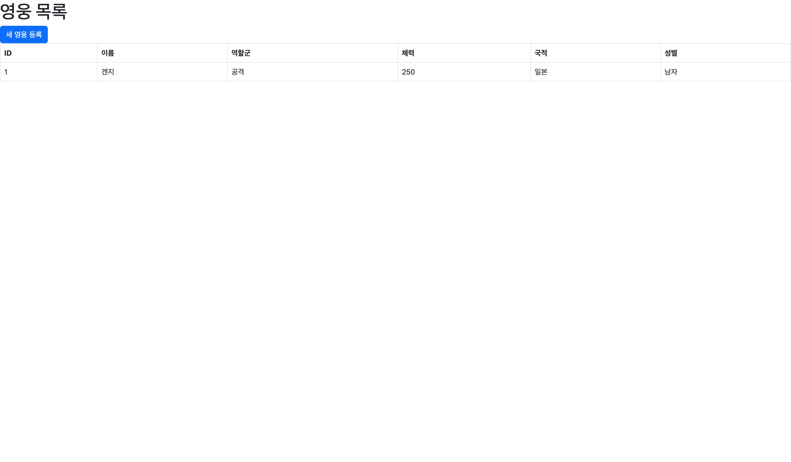
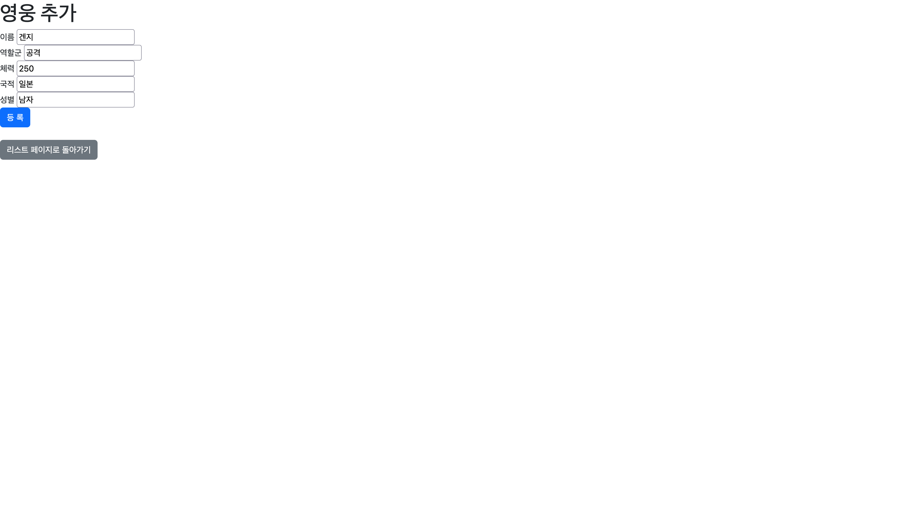

# Hero Management Web Application

Spring Boot와 Thymeleaf를 이용한 오버워치 Hero 관리 웹 애플리케이션입니다.

## 프로젝트 소개

- **주제**: 오버워치 Hero 관리 프로그램
- **배포 URL**: https://my-hero-webui.onrender.com/heroes
- **기술 스택**: Spring Boot 4.1.1, Thymeleaf, Bootstrap 5, Java 17
- **저장소**: Java Collection (Map) 기반 In-Memory 저장

## 프로젝트 구조

```
src/main/java/com/example/sb_crud_webui/
├── controller/
│   ├── HeroWebController.java    # Web UI 요청 처리 (@Controller)
│   └── HeroRestController.java   # REST API 처리 (@RestController)
├── service/
│   └── HeroService.java          # 비즈니스 로직
├── repository/
│   ├── HeroRepository.java       # Repository 인터페이스
│   └── MemoryHeroRepository.java # In-Memory 구현체
├── domain/
│   └── Hero.java                 # Hero 도메인 클래스
└── dto/
    ├── HeroRequest.java          # 입력 DTO
    └── HeroResponse.java         # 출력 DTO

src/main/resources/
├── templates/
│   └── heroes/
│       ├── list.html             # Hero 목록 화면
│       └── form.html             # Hero 등록 화면
└── static/
    └── css/
        └── style.css
```

## 실행 방법

```bash
# 프로젝트 루트에서 실행
./gradlew bootRun
```

브라우저에서 `http://localhost:8080/heroes` 접속

## Web Endpoint

| HTTP Method | URL | 기능 |
|---|---|---|
| GET | /heroes | 전체 Hero 목록 |
| GET | /heroes/new | Hero 등록 Form |
| POST | /heroes | Hero 데이터 등록 |

## 주요 화면

### 목록 화면 (`GET /heroes`)



### 등록 화면 (`GET /heroes/new`)


---

## 이번 과제 키워드

- `@Controller` — View 이름을 반환하는 Web 요청 처리
- `Thymeleaf` — 서버 사이드 템플릿 엔진
- `Model` — Controller에서 View로 데이터 전달
- `@ModelAttribute` — HTML Form 데이터를 DTO로 바인딩
- `HTML Form` — 사용자 입력 데이터 전송
- `redirect:` — 요청 후 다른 URL로 리다이렉트
- `PRG Pattern` — Post → Redirect → Get 패턴
- `Bootstrap` — 반응형 UI 컴포넌트 라이브러리
- `Layered Architecture` — Controller / Service / Repository 계층 분리

## 핵심 내용 정리

1. **`@Controller`와 `@RestController`의 차이**
   `@RestController`는 반환값을 JSON으로 직렬화하여 응답하고, `@Controller`는 반환값을 View 이름으로 해석하여 Thymeleaf 템플릿을 렌더링한다.

2. **Model을 이용한 데이터 전달**
   Controller에서 `model.addAttribute("heroes", heroService.findAll())`로 데이터를 담으면, Thymeleaf에서 `${heroes}`로 접근할 수 있다.

3. **Thymeleaf로 Collection 출력**
   `th:each="hero : ${heroes}"`로 List를 순회하고, `th:text="${hero.name}"`으로 각 필드 값을 출력한다.

4. **`@ModelAttribute`로 Form 데이터 수신**
   HTML Form의 `input name` 속성이 DTO 필드명과 일치하면 Spring이 자동으로 객체에 바인딩해준다.

5. **PRG Pattern (Post → Redirect → Get)**
   POST 요청 처리 후 `return "redirect:/heroes"`로 GET 요청으로 전환하면, 브라우저 새로고침 시 데이터가 중복 등록되는 문제를 방지할 수 있다.

---

## Weekly Report

### Key Learning
1. `@Controller`와 `Model`을 이용한 서버 사이드 렌더링 방식 이해
2. Thymeleaf 문법(`th:each`, `th:text`, `th:href`, `th:action`)을 활용한 동적 HTML 생성
3. PRG Pattern의 필요성과 동작 방식

### Web UI Flow
```
Browser
  → GET /heroes
  → HeroWebController.list()
  → HeroService.findAll()
  → MemoryHeroRepository.findAll()
  → List<HeroResponse>
  → Model.addAttribute("heroes", ...)
  → Thymeleaf
  → list.html
```

### Form Flow
```
HTML Form (POST /heroes)
  → HeroWebController.create(@ModelAttribute HeroRequest)
  → HeroService.create(request)
  → MemoryHeroRepository.save(hero)
  → redirect:/heroes
  → GET /heroes
  → list.html
```

### Problem & Solution
- **문제**: `<button>` 안에 `<a>` 태그를 중첩하여 Bootstrap 버튼 글자색이 보이지 않는 문제 발생
- **해결**: `<button>` 제거 후 `<a>` 태그에 직접 `class="btn btn-primary"` 적용

### Code Review
```java
@PostMapping
public String create(@ModelAttribute HeroRequest request) {
    heroService.create(request);
    return "redirect:/heroes";
}
```
HTML Form 데이터가 `@ModelAttribute`를 통해 `HeroRequest`로 자동 바인딩되고,
처리 후 `redirect:`로 GET 요청을 유도하는 PRG Pattern의 핵심 코드.
중복 등록 방지와 데이터 흐름을 동시에 해결하는 중요한 구조라고 생각한다.

### AI Usage
- Bootstrap UI 구조 생성 시 AI 활용
- 생성된 코드에서 `th:action`, `th:href` URL, `input name`과 DTO 필드명 일치 여부를 직접 확인 및 수정

### Reflection
`redirect:`가 단순히 페이지를 이동시키는 것이 아니라, 브라우저에게 새로운 GET 요청을 보내도록 지시한다는 점이 인상적이었다. PRG Pattern이 없으면 새로고침만으로 데이터가 중복 등록될 수 있다는 것을 직접 확인하면서 왜 이 패턴이 필요한지 이해하게 되었다.
